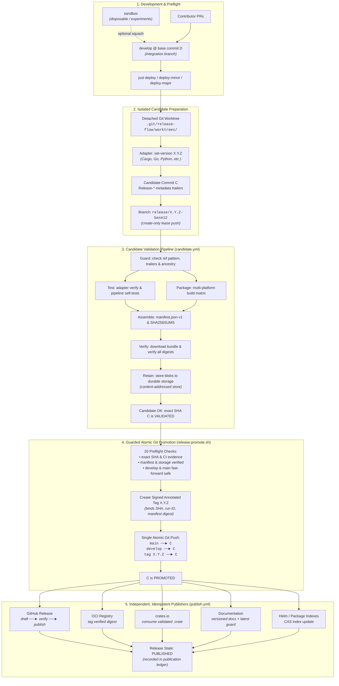
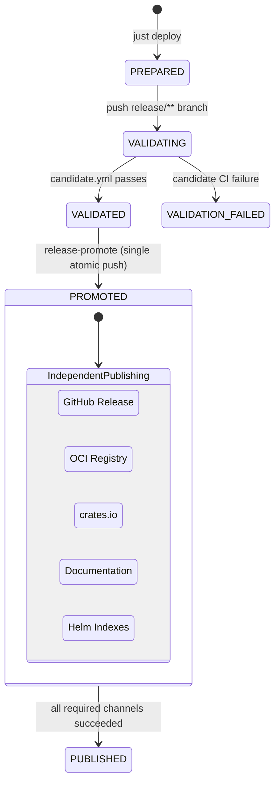

# release-flow

[](https://github.com/nbari/release-flow/actions/workflows/ci.yml?query=branch%3Asandbox)
[](https://github.com/nbari/release-flow/actions/workflows/ci.yml?query=branch%3Adevelop)
[](#implementation-progress)
[](LICENSE)

**Reliable, independent, and recoverable release workflows.**

`release-flow` is a practical reference project for building software releases that are **validated before promotion**, **promoted without partial Git ref updates**, and **published through independently retryable channels**. Its Rust CLI is useful for inspecting release readiness; the **release pipeline is the primary project**. The project will eventually release its own binary using the process described here, then serve as a reusable pattern for other repositories.

> **Status: Milestones 1–3 implemented.** The Rust CLI (`status`, `plan`, `check`), isolated worktree candidate preparation, the language-agnostic adapter, the multi-platform candidate pipeline, guarded atomic promotion (`just release-promote`), durable content-addressed storage and independently recoverable publishers (`just release-status`, `just release-retry`) are implemented and covered by failure-injection tests. Dogfooding a real release of `release-flow` waits on durable storage and rulesets being provisioned for this repository (see [RULESETS.md](docs/RULESETS.md)).

## The release contract

1. **One release = one version + one exact source commit + one verified artifact inventory.** Branch names and "latest" are never sufficient release identities.
2. **Validate before promotion.** All required tests, builds, packages, checksums, and supply-chain checks complete for the *exact candidate SHA*. A failure must not change `main`, `develop`, or a public version tag.
3. **Promote Git refs atomically.** Move `main` and `develop` to the validated commit and create its signed version tag in a single `git push --atomic`. All refs update, or none do. No merge or squash may change the validated commit after the candidate passes.
4. **Never modify a published identity.** No moving/deleting/reusing release tags and no "rebuild the same version" after promotion. A publisher must use the original verified bytes or image digests.
5. **Publication is not a Git transaction.** GitHub Releases, OCI registries, docs, and Helm are separate failure domains. Each can retry independently and idempotently **without a new commit, tag, version, or CI rebuild**.
6. **Fail closed and be observable.** Unknown CI state, stale candidate, missing artifacts, conflicting published content, or insufficient permissions block the affected operation. Record which step succeeded and exactly how to resume.
7. **No hidden branch rewrites.** Release automation never resets, force-pushes, or auto-syncs anyone's `sandbox` branch.

The target is a *recoverable release*, not an impossible all-or-nothing transaction spanning Git and external services.

## Release flow



**Key distinction:** `git push --atomic` gives an atomic boundary **only for Git refs at the same remote**. Artifact stores and deployment targets are reconciled independently afterward. A failed publisher does not roll back a successful promotion.

## Branches and authority

| Ref | Purpose | Who may modify it |
| --- | --- | --- |
| `main` | Released, stable history only | Dedicated release identity through a guarded promotion; no routine human commits |
| `develop` | Integration branch for contributors and CI | PRs by default; authorized maintainer fast-forward when explicitly requested; release promotion |
| `sandbox` | Free-form experimentation and agent work | Its owner or explicitly authorized collaborators; **never** release automation |
| `release/<version>-<base-sha>` | Temporary, isolated versioned candidate | Candidate-preparation automation only |
| `X.Y.Z` | Immutable version tag pointing at the validated release commit | Created once by authorized release promotion |

`main` and `develop` should remain linear; promotion must be a fast-forward of both. `sandbox` commits can be squash-integrated into `develop` **before** creating a candidate, never afterward. An integration-branch change while a candidate is being tested invalidates its promotion eligibility; test a fresh candidate against the new base rather than force-pushing.

**Production protection is an owner action.** [RULESETS.md](docs/RULESETS.md) and `docs/rulesets/*.json` define the rulesets: `main` and `develop` deletion/non-fast-forward protection, the required `Candidate OK` check on `main`, `main` updates and release-tag creation restricted to the single release deploy key, immutable release tags and immutable `release/**` candidates. An unconditional "PR required" policy on `main` would conflict with direct atomic promotion, so promotion uses a narrowly scoped deploy-key bypass, never a blanket admin bypass. `just release-promote` refuses to promote (PF20) until the rules are in place, and still verifies the exact candidate and ref ancestry itself.

## Detailed release protocol

### 1. Preflight and candidate preparation

From up-to-date `develop`, choose `patch`, `minor`, `major`, or an explicitly supported unreleased-current version. Compute the version relative to the latest *promoted* version, not merely the local manifest. Refuse a dirty checkout, missing tools/credentials, tag collision, unexpected divergence, or another active promotion.

Create an **isolated Git worktree** and a versioned candidate commit `C` on a temporary `release/*` branch. Update the Cargo workspace version and lockfile, plus any declared version-bearing inputs, *before* testing. The candidate remains separate from `main` and `develop` until fully validated. Keep failed candidates diagnosable; clean them up only after safe resolution.

This is also a good place to produce an auditable release plan: chosen version, base SHA `D`, candidate SHA `C`, changed manifests, required gates, and planned publishing channels.

### 2. One authoritative validation for C

The candidate workflow must identify `C` by SHA, never by whichever commit happens to be at the branch tip when a later step executes.

- Run formatting, Clippy, tests, policy/security checks, and every required platform build for `C`.
- Create distributable archives, packages and OCI images **before** promotion. Keep OCI candidates addressable by immutable digest (not only mutable tags).
- Produce and independently verify a manifest containing the version, candidate commit SHA, base SHA, CI run ID, build/toolchain information, artifact names and SHA-256 digests, and any OCI digest/provenance references.
- Download built artifacts into a separate verification job. Verify complete inventory, exact hashes, source identity, and installation/smoke tests. Reject extra, missing, or mismatched artifacts.
- Retain the validated bytes in **durable, immutable storage** for the supported recovery period. GitHub Actions artifact retention alone is insufficient as a permanent recovery strategy.

Avoid rerunning the entire test/build matrix just because `main` and a tag subsequently point to the already-tested SHA. Ordinary `develop` CI can provide early feedback, but the candidate's verified evidence for `C` is the release authority.

**If validation fails:** no version tag or production refs change. Retry a transient failed stage against the same candidate; if source code or build inputs change, treat that as a **new SHA and new candidate validation**. The unpublished intended version may still be reused because it was never released.

### 3. Guarded, atomic Git promotion

Immediately before promotion, reacquire authoritative remote ref state. Verify the candidate's identity, successful required CI on `C`, manifest availability, signed-commit policy, tag absence, authorization, and that advancing **both** destination branches to `C` is still a fast-forward.

Create an annotated signed version tag on `C`, then use a **single atomic push** for `main`, `develop`, and the tag:

```sh
# Illustrative promotion only: run via the verified release automation.
git push --atomic origin \
  <candidate-sha>:refs/heads/main \
  <candidate-sha>:refs/heads/develop \
  refs/tags/X.Y.Z
```

If any ref is rejected or either branch advances incompatibly, the atomic push fails: **no ref is partially promoted**. Do not force-push. Verify the remote result afterward and record `PROMOTED` only when the remote tag, `main` and `develop` match the validated identity. Never treat a lost CLI response as evidence that promotion failed: inspect the remote before retrying.

### 4. Independent, idempotent publishers

All publishers first resolve the immutable **version → C → manifest** record. They must not rebuild binaries or retest unrelated platforms.

| Publisher | Successful state | Safe retry |
| --- | --- | --- |
| GitHub Release | Complete inventory uploaded to a draft, rechecked against the manifest, then published (prefer immutable releases) | Resume an incomplete draft; if already published, verify exact assets and return success or flag conflict |
| OCI images | Validated manifests/indexes copied or tagged by digest | Verify remote digests; retry only missing/mismatched **unpublished** targets, never silently overwrite a conflicting release |
| Documentation | Version-specific content published from the validated source | Retry version-specific publish; update mutable "latest" only if this is still the newest eligible version |
| Helm / package indexes | Versioned package/index entry points at validated artifacts | Retry independently; protect mutable index/latest references from older runs |

**Independent means no artificial `needs: github-release` edge for OCI, documentation, or Helm.** Real dependencies may be modeled explicitly (for example Helm requiring the *image digest*), but a failure in GitHub Release publishing must not block an unrelated image publish.

A GitHub tag workflow has code frozen at its tagged commit. If that publishing logic is broken, recovery must be possible through **current approved publisher code** while still verifying the **original signed tag, candidate SHA, and manifest**. Updating a tag or incrementing the version to escape a workflow bug is forbidden.

For an immutable GitHub Release, upload to a draft, verify all assets, then publish exactly once; do not design retries that require replacing assets after publication.

### 5. Recovery and state reconciliation

Release states are explicit:



The **artifact manifest is immutable**; the publisher status/attempt ledger is separately updateable. Each attempt records version, `C`, channel, workflow run, timestamps, observed digest/state, and an actionable error. Recovery reads actual remote state first; it must not assume that an interrupted job did nothing.

`just release-retry X.Y.Z <channel>` reruns one publisher without rerunning promotion: by default it dispatches `publish.yml` with current approved publisher code (`--ref`, default `promotion.publisher_ref`), `--local` runs it from your checkout, and `--break-lock` clears an expired publication lock first. `just release-status X.Y.Z [--json]` derives the state above from the remote tag, the durable ledger and the GitHub evidence.

### Required failure-injection scenarios

| Failure | Expected response | Test |
| --- | --- | --- |
| Build/test/check fails | No `main`/`develop`/tag update; fix or retry candidate | PR03 |
| `develop` advances after candidate validation | Reject stale promotion; regenerate/revalidate candidate | PR06 |
| Two promotion attempts race | At most one accepted version/tag promotion | PR15, PR16 |
| Atomic push is rejected | No production ref changes; inspect and retry safely | PR12 |
| Process loses response after atomic push | Read remote refs/tag; resume publishing if already promoted | PR13 |
| Interrupted after the local tag is created | Remote unchanged; rerun reuses the signed local tag | PR14 |
| GitHub Release upload fails | Resume its draft/asset verification only | PB02, PB03 |
| OCI publish fails after GitHub Release succeeds | Retry OCI only, with original digest | PB08 |
| Old docs/Helm/OCI job finishes late | Never replace a newer `latest` pointer | PB09, PB11 |
| Artifact checksum differs / storage expires | Block that publish; do not fabricate replacement bytes | PR09, PR10, PB05, PB06 |
| Tag-workflow implementation has a bug | Use trusted current recovery workflow; same signed tag + original artifacts | IN03 |
| Publisher retried twice concurrently | Lock/reconcile; identical result is success, conflict is failure | IN02 |

All of these run in `just pipeline-test` (`tests/pipeline/test-promote.sh`, `test-publishers.sh`, `test-storage.sh`, `test-integration.sh`).

## Current implementation

The existing Rust binary is **read-only**:

```sh
cargo build --locked

cargo run --locked -- status
cargo run --locked -- status --json
cargo run --locked -- plan minor
cargo run --locked -- check
cargo run --locked -- check --local-only --json

just check
just build
```

- `status` inspects the checkout, Cargo version, local/remote tags, branch relationships, and recent Actions runs. Remote information may be unavailable or stale.
- `plan patch|minor|major` previews a version change and blockers; it does not change Git or Cargo files.
- `check` evaluates release eligibility and fails closed when required evidence is missing. `--local-only` limits the checks to local evidence; it is **not** a substitute for authoritative remote CI verification.
- `--json` is intended for CI consumers; automation should inspect both the structured verdict and process exit code.

The [CI workflow](.github/workflows/ci.yml) runs formatting, Clippy, unit and integration tests, candidate failure tests, and CLI checks.

The [Candidate workflow](.github/workflows/candidate.yml) is triggered automatically on push to temporary `release/**` branches. It enforces exact candidate identity and trailers via `scripts/candidate-guard.sh`, runs the project tests, packages every adapter target in a matrix (`scripts/candidate-targets.sh`), assembles one immutable `manifest.json` with `SHA256SUMS`, downloads and verifies the artifacts in an isolated job, and, for production candidates, retains the verified bytes and a candidate record in durable storage (`scripts/storage/storage.sh retain-candidate`). It is the only place release artifacts are built.

The [Publish workflow](.github/workflows/publish.yml) runs on the signed tag push with one job per channel (GitHub Release, OCI, crates.io, docs, Helm) and no `needs:` between them; each resolves the signed tag and the stored bytes on its own.

### Promoting and publishing

```sh
just release-promote release/X.Y.Z-<base12> <candidate-sha> --dry-run   # preflight only (PF01-PF20)
just release-promote release/X.Y.Z-<base12> <candidate-sha>             # signed tag + one atomic push
just release-status X.Y.Z                                               # PROMOTED / PUBLISHED and per-channel state
just release-retry X.Y.Z oci                                            # rerun one publisher (dispatch; --local to run here)
```

Promotion runs locally with the release operator's credentials: the single write deploy key configured as `promotion.push_remote` and a signing key registered on GitHub. It never builds, never force-pushes and never moves or deletes a tag; whatever the push reports, the verdict comes from re-reading the remote (exit codes 10–14 tell you whether to rerun, prepare a new candidate or repair by hand).

### Preparing a candidate

The primary interface is `just deploy`. The branch you are on selects the policy; candidates are prepared in an isolated Git worktree without modifying `develop`, `sandbox`, `main`, or your active checkout, and pushing the `release/**` branch triggers the Candidate workflow:

```sh
just deploy         # patch bump
just deploy-minor   # minor bump
just deploy-major   # major bump
```

| Current branch | Result |
| --- | --- |
| `test_base` (`sandbox`) | Test-only candidate `release/test/X.Y.Z-<base12>`, never promotable |
| `production_base` (`develop`) | Production candidate `release/X.Y.Z-<base12>` |
| `main`, `release/*`, detached HEAD, anything else | Rejected (exit 3) without any Git change |

Your local branch must match its remote exactly (no unpushed or unpulled commits); the commit you are on is the commit that is released. On success, `key=value` lines (including `candidate_branch`, `candidate_commit` and a GitHub `ci_url`) are printed on stdout.

The low-level preparation tool remains available for explicit control:

```sh
just release-prepare patch                          # production candidate from develop, not pushed
just release-prepare patch --mode test-only --push  # test-only candidate from sandbox
```

See [ADOPTION.md](docs/ADOPTION.md) for the deploy module, the versioned installer bundle, the adapter interface, and adopting `release-flow` in other projects.

## Implementation progress

| Milestone | Status | Exit criterion |
| --- | --- | --- |
| Read-only `status` / `plan` / `check` CLI | **Implemented** | Green [sandbox CI](https://github.com/nbari/release-flow/actions/workflows/ci.yml?query=branch%3Asandbox) |
| Worktree + versioned temporary candidate | **Implemented** | Isolated worktree preparation; no production ref changes |
| Reusable adapter contract & Cargo reference | **Implemented** | Project-independent adapter protocol v1 |
| Exact-SHA candidate pipeline & manifest v1 | **Implemented** | Same-run verification; pinned manifest hash; independent verifier |
| Pipeline failure-injection test suite | **Implemented** | All 10 test suites pass in `just check` |
| Branch-aware `just deploy` + versioned bundle | **Implemented** | Branch policy, rejection-without-changes and bundle installer suites pass |
| Atomic exact-SHA promotion + signed tag + rulesets | **Implemented** | PR01–PR18 (race, stale branch, rejected and lost pushes, interruption, protection, signing) |
| Durable manifest + independent publishers | **Implemented** | ST01–ST09, PB01–PB11: retry one publisher without rebuilding or retagging |
| Complete recovery / fault-injection suite | **Implemented** | IN01–IN04 end to end through `just` |
| Dogfood a real release of `release-flow` | **Planned** | Needs durable storage (`storage.uri`) and the rulesets applied; self-release can recover interrupted publishers |

**Source of truth:** This README states the release contract. [Release design](docs/RELEASE_DESIGN.md) expands the invariants, state machines and failure cases; [RULESETS.md](docs/RULESETS.md) the server-side protection; [AGENTS.md](AGENTS.md) covers contributor/agent guidelines.

Licensed under [BSD-3-Clause](LICENSE).
