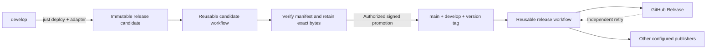

# Release Flow

Define how your project builds. Release Flow handles release candidates,
verification, promotion, and publishing.

Release Flow is a language-independent release pipeline for GitHub. Give it a
small project adapter; keep the release orchestration in shared workflows.
Use the **Release Flow Provenance** Action to check configuration in any job.
No Rust or Docker installation is required to use the Action.

## Why Release Flow?

- Build a candidate once, verify its inventory and digests, and retain those bytes.
- Promote the exact validated commit with a signed, immutable version tag.
- Publish independently to configured destinations; retry a failed destination
  without rebuilding artifacts or repeating successful publication.
- Keep application behavior in your adapter and release operations in managed files.

The Rust binary in this repository is a reference application that exercises the
pipeline. Consumers use Just, shell adapters and GitHub Actions.

## How It Works



Local Just commands prepare candidates and operate releases. The Marketplace
Action validates configuration in a **step** without executing the adapter.
The reusable workflows run the complete multi-job pipeline. Your adapter owns
version changes, tests, build targets, artifact inventory and packaging.

`main` contains promoted releases; `develop` is the integration branch;
`sandbox` is for experiments. Promotion advances `main` and `develop` together.
The separate `release-flow-storage` branch stores release evidence and is never
merged into application branches. See [branch lifecycle](docs/BRANCHES.md).

## Quick Start

You need Git 2.31+, Bash 3.2+, jq 1.6+, Just 1.27+ and GitHub CLI for local
release operations. Candidate packaging uses Linux runners and GNU tar. Build
tools are chosen by your adapter.

Follow the executable [installation guide](docs/ADOPTION.md#installation) to
verify and install a published distribution bundle, or build it from a pinned,
clean source checkout. The bundle installs local scripts and thin, SHA-pinned
workflow callers. Your root `.justfile` needs one line:

```just
import '.justfiles/deploy.just'
```

Try the complete [acme/hello shell application](examples/shell/README.md). It
requires neither Cargo nor a container registry and publishes only to GitHub.

## Integrate With Your Project

Your project owns these files:

```text
.justfile                          # imports the managed deploy module
.release-flow.json                 # repository, pins, storage, publishers
tools/adapter.sh                   # your executable adapter
VERSION                            # or your project's version file
.github/workflows/candidate.yml    # installed pinned caller
.github/workflows/release.yml      # installed pinned caller
.justfiles/ + scripts/             # managed bundle support; do not edit
```

The adapter implements `version`, `set-version`, `verify`, `targets`, `inventory`
and `package`. See the [protocol and full configuration](docs/ADOPTION.md).
Rust projects can install the optional Cargo adapter with `--with-cargo-adapter`.

Before the first production candidate, configure immutable GitHub storage,
signing, environments and branch/tag rules. The [owner setup](docs/RULESETS.md)
and [GitHub storage guide](docs/GITHUB_STORAGE.md) explain those one-time steps.
Storage can also use S3 or a local file store; GitHub is the simplest hosted path.

## GitHub Marketplace Action

Use the reviewed full commit SHA recorded in your installed
`.release-flow-bundle.json.source_commit` wherever `FULL_SHA` appears below.
The [Marketplace guide](docs/MARKETPLACE.md) records publication requirements
and the public listing's activation state.

```yaml
permissions:
  contents: read
jobs:
  validate:
    runs-on: ubuntu-24.04
    steps:
      - uses: actions/checkout@3d3c42e5aac5ba805825da76410c181273ba90b1 # v7
        with:
          persist-credentials: false
      - uses: nbari/release-flow@FULL_SHA
        id: validation
        with:
          operation: validate
          adapter: tools/adapter.sh
```

Validation checks configuration, tools, safe paths and the declared adapter
contract. It never invokes adapter commands or mutates the project. Outputs
include `project`, `adapter`, `project-directory`, `runtime-revision` and
`validation-json`. Linux and macOS runners need Bash, Git and jq.

## Reusable GitHub Workflows

These references belong at the **job** level. The installer renders the full
SHA into both callers and supplies a matching example `pipeline.sha`.

```yaml
name: Candidate
on:
  push:
    branches: ['release/**']
permissions:
  contents: read
jobs:
  candidate:
    uses: nbari/release-flow/.github/workflows/candidate.yml@FULL_SHA
    with:
      adapter: tools/adapter.sh
    permissions:
      contents: write
      id-token: write
```

```yaml
name: Release
on:
  push:
    tags: ['[0-9]+.[0-9]+.[0-9]+']
permissions:
  contents: read
jobs:
  release:
    uses: nbari/release-flow/.github/workflows/release.yml@FULL_SHA
    permissions:
      contents: write
      id-token: write
```

Candidate build jobs receive read-only source access. Only the retention job
receives storage write permission. GitHub storage uses the consumer's GitHub
token; optional S3 uses OIDC or explicitly named credentials. Full caller
examples, including dispatch-based retries, are in [ADOPTION.md](docs/ADOPTION.md).

## Prepare and Promote a Release

From a clean, synchronized integration checkout:

```bash
git switch develop
just deploy                         # patch; leaves develop unchanged
# just deploy-minor
# just deploy-major
just release-candidates
just release-status X.Y.Z
```

`just deploy` pushes `release/X.Y.Z-<base12>` with a version bump commit in an
isolated temporary worktree. GitHub validates that exact candidate, builds each
target, verifies `manifest.json` and `SHA256SUMS`, and retains the original bytes.
On `sandbox`, deploy creates a `release/test/...` candidate that cannot be promoted.

After inspecting successful CI and retention, an authorized operator runs:

```bash
just release-promote release/X.Y.Z-<base12> <candidate-sha> --dry-run
just release-promote release/X.Y.Z-<base12> <candidate-sha>
```

All preconditions must pass. Promotion atomically advances `main` and `develop`
and creates the signed tag. Publishing reuses the retained artifacts. Never
push `main` directly or move a version tag. See [release design](docs/RELEASE_DESIGN.md).

## Recover a Failed Release

```bash
just release-status X.Y.Z --json
just release-retry X.Y.Z github-release
just release-prune --dry-run
```

A failed candidate is fixed by committing the change to its base and preparing
a fresh candidate. A stale base needs a fresh candidate too. A failed publisher
is retried independently for the same version and bytes. Status and dry-run
cleanup are read-only. Explicit cleanup keeps unpublished production candidates;
see [candidate management](docs/CANDIDATES.md) before using `--apply`.

## Upgrading Release Flow

Verify the next bundle, run `install.sh --target . --upgrade`, and review the
changes. Align the Action reference, both reusable workflow references and
`.release-flow.json.pipeline.sha` with the new bundle's source commit. The
installer rejects edits to managed files and never overwrites your configuration
or adapter. Run `--check` to detect drift. See [upgrades](docs/ADOPTION.md#upgrades).

## Examples

- [Shell application: acme/hello](examples/shell/README.md) — complete adoption path.
- [Cargo adapter](scripts/adapters/cargo.sh) — reusable Rust project behavior.
- [Reference adapter](scripts/adapters/release-flow.sh) — Rust binaries, crate
  archive and this project's distribution bundle. This repository publishes
  these files as GitHub Release assets; crates.io publication is optional and
  is not enabled for its Marketplace release.

## Security

Pin Actions, reusable workflows and installed runtime to full commit SHAs.
Workflow/runtime identity and consumer source identity are checked separately.
Untrusted PRs must never execute adapters with publisher credentials; avoid
`pull_request_target`. Validation needs no secrets, OIDC or network downloads.
Release tags and retained artifacts are immutable. Publisher locks and durable
receipts make retries recoverable. See [security model](docs/RELEASE_DESIGN.md) and
[verification evidence](docs/VERIFICATION.md).

## Documentation

[Adoption](docs/ADOPTION.md) · [Marketplace](docs/MARKETPLACE.md) ·
[Release design](docs/RELEASE_DESIGN.md) · [Branches](docs/BRANCHES.md) ·
[Candidates](docs/CANDIDATES.md) · [Rulesets](docs/RULESETS.md) ·
[GitHub storage](docs/GITHUB_STORAGE.md) · [Live verification](docs/VERIFICATION.md)

BSD-3-Clause licensed. Repository-native checks: `just check` and `just pipeline-test`.
