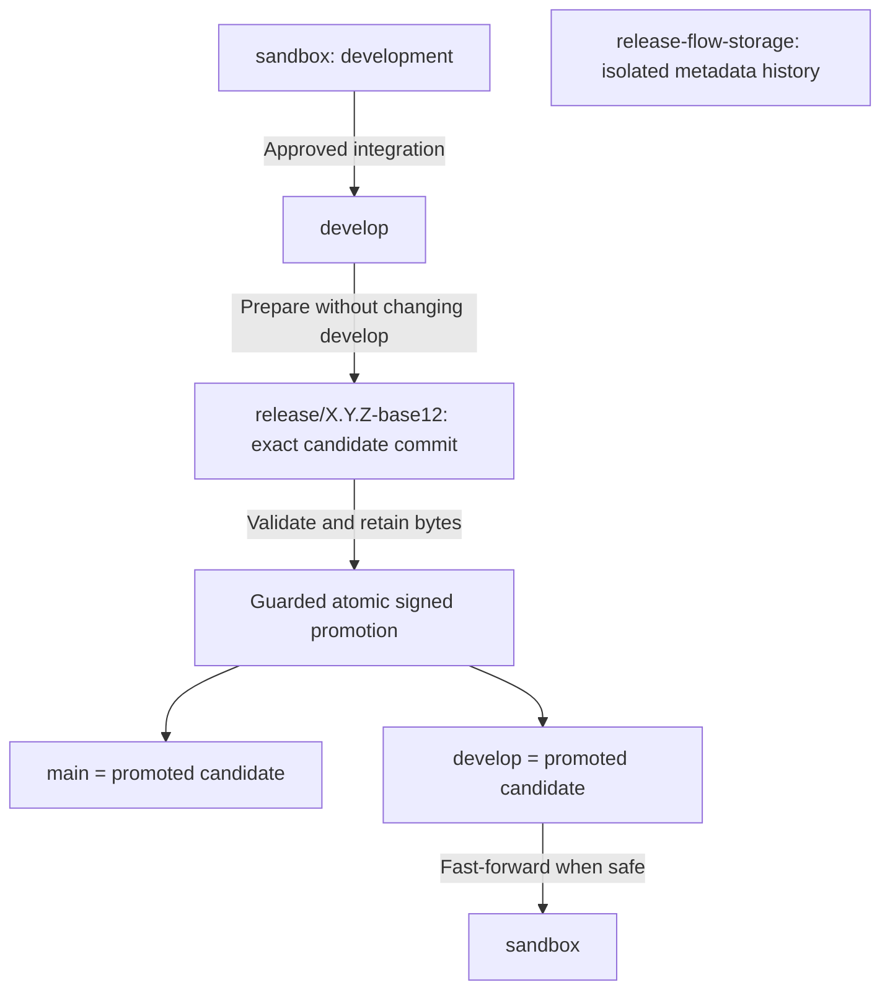

# Branch lifecycle

`main` advances only through authorized release promotion. `develop` accepts
reviewed changes under its ruleset. An explicitly authorized maintainer can
integrate by fast-forward as allowed by repository policy. `sandbox` is not
rewritten by release operations. These branches need not be equal during work;
a successful promotion makes `main` and `develop` equal to the validated candidate.
Fast-forward `sandbox` afterward only if no work would be lost.

Candidate branches are create-only identities with one version bump commit on
the recorded base. Test candidates are `release/test/X.Y.Z-base12` and cannot
be promoted. Fixes belong on the base followed by a fresh candidate. Never
rebase or amend a pushed candidate to repair it.

`release-flow-storage` is an independent protected Git metadata history, never
merged, rebased or synchronized with application branches. Its small records
point at immutable content-addressed retained GitHub assets. Signed version
tags, release artifacts and publication ledger records outlive candidate branches.
See [candidate cleanup](CANDIDATES.md).

For the Marketplace release, this repository requires only the `github-release`
publisher. The prior required `crates-io` destination was removed in a reviewed
configuration change because Marketplace authorization covers GitHub publication
only. The Rust reference still builds and tests its crate archive; the independent
crates.io publisher and recovery tests remain available for explicitly authorized
consumers. No crates.io/OCI/docs/Helm publication is requested by this configuration.
